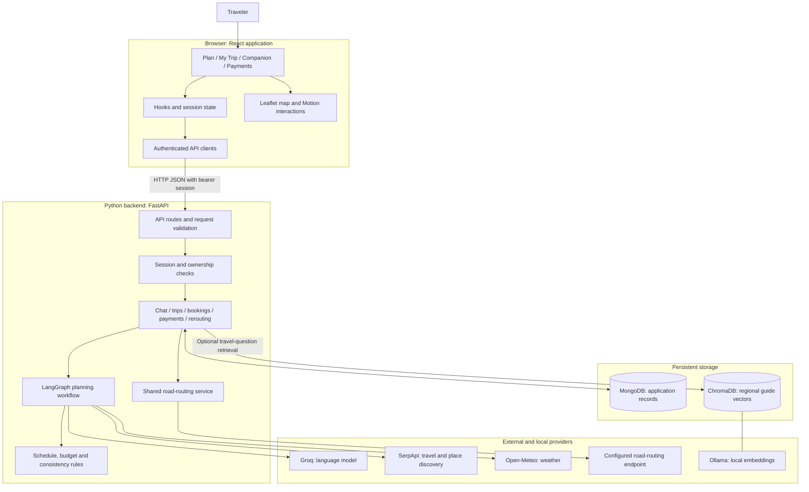
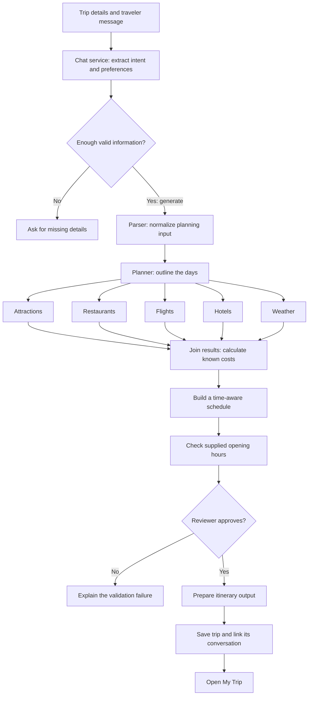
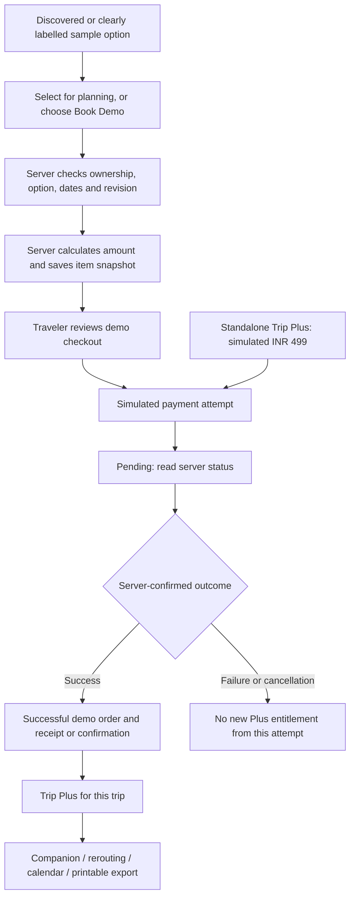

# TravelAI architecture and workflow

This guide describes the current workspace implementation. It explains the system for development, demonstrations and project presentations. It is not a claim that every external provider is currently available.

## 1. What the project does

TravelAI turns a travel conversation and preferences into a saved itinerary. Travelers review places, maps, flights, hotels, weather and known costs. Demo purchases unlock Companion Mode for the purchased trip. During travel, travelers can record progress and review proposed schedule adjustments before accepting them.

The main journey is **Plan → My Trip → Companion**. Editing preferences does not itself change a saved itinerary. Selecting a flight or hotel does not itself book it.

## 2. System architecture



| Part | Responsibility | Main code |
|---|---|---|
| React + TypeScript | Screens, forms, user feedback and navigation | [App.tsx](../Frontend/src/App.tsx), [pages](../Frontend/src/pages) |
| Tailwind + Motion | Existing styling, transitions and reduced-motion support | [motion](../Frontend/src/motion) |
| Frontend hooks | Connect the screens to saved trips, conversations and booking status | [useTravelApi.ts](../Frontend/src/hooks/useTravelApi.ts), [useTripBookings.tsx](../Frontend/src/hooks/useTripBookings.tsx) |
| API clients | Send authenticated requests and retain useful HTTP errors | [api.ts](../Frontend/src/services/api.ts), [planningProgress.ts](../Frontend/src/services/planningProgress.ts) |
| FastAPI routes | Validate incoming requests and enforce authentication | [main.py](../Backend/app/main.py), [api](../Backend/app/api) |
| Python services | Implement application rules and database operations | [services](../Backend/app/services) |
| LangGraph | Run planning stages in the required order and fan out discovery work | [langgraph_graph.py](../Backend/app/ai/orchestrator/langgraph_graph.py) |
| PyMongo + MongoDB | Persist user-owned application records | [mongodb.py](../Backend/app/database/mongodb.py) |
| ChromaDB + Ollama | Retrieve relevant regional reference text for travel questions | [rag](../Backend/app/ai/rag), [qa_service.py](../Backend/app/services/qa_service.py) |

This is a **layered client/server application**. Its agents are specialized steps in one backend, rather than independently deployed microservices. The database client is synchronous PyMongo, not Motor.

## 3. Planning workflow

Example request: “Plan a 3-day Goa trip for 2 adults with a total budget of ₹60,000.”



The five discovery branches can run in parallel. Later scheduling uses their combined results. The reviewer can reject an unsafe schedule or a fixed budget exceeded by known costs. The current graph does **not** automatically loop rejected plans until one succeeds.

“Agent” does not mean every step makes an LLM call. Language-model assistance handles language interpretation and selected content tasks; Python code also calculates costs, schedules visits and enforces consistency. A language-model response alone is not proof that a place exists, a timetable fits or a booking succeeded.

### Real planning progress

1. The browser creates a stable request ID and sends `POST /api/chat/requests`.
2. The backend saves an owned request record and returns promptly. A bounded in-process executor runs the chat/planning operation.
3. Actual stage callbacks update `planning_requests`. The browser polls `GET /api/chat/requests/{request_id}` approximately once a second.
4. The UI distinguishes running checks, completed checks and unavailable results. It does not invent a completion percentage.
5. Refresh reads the same request reference from owner-scoped session storage. Reusing the same ID and input reuses the request; tracked trip saves also have a unique request key.
6. Completed results are delivered to the existing chat and itinerary UI. A temporary status-connection failure offers **Check status**, rather than starting another plan.

This is polling, not WebSockets or a durable distributed job queue. A server restart marks unfinished requests interrupted rather than resuming their Python execution. Terminal request records have a seven-day TTL; saved trips remain separate. Requests with no recorded progress for fifteen minutes are treated as interrupted when checked. The older synchronous `/api/chat/message` route remains available for compatibility.

## 4. Demo booking and Plus workflow



- **Selected** means included in the planning choices. **Booked — Demo** means a matching successful demo order exists. They are different states.
- Flight/hotel demo orders and standalone upgrades share the `payments` collection. There is no separate real reservation system.
- The standalone upgrade has its own server-set simulated INR 499 price; it is not an extra charge added to a flight/hotel demo order.
- The browser identifies the option; the server resolves it and calculates the amount. Browser-supplied entitlement flags are not trusted.
- Successful orders preserve the original item and price snapshot. Later estimate changes must not rewrite a past confirmation.
- Plus access is derived from a successful eligible order belonging to that user and trip. It is checked on protected backend actions, as well as displayed in the UI.
- All purchases are simulated: no money, ticket, PNR, hotel reservation or tax invoice is created.

## 5. Companion and dynamic routing workflow

```mermaid
sequenceDiagram
    actor Traveler
    participant UI as Companion UI
    participant API as FastAPI
    participant Engine as Reroute engine and road service
    participant DB as MongoDB
    Traveler->>UI: Skip/replace, running late or place closed
    UI->>API: Preview with activity ID and expected revision
    API->>DB: Check owned trip, Plus access and saved state
    API->>Engine: Evaluate feasible choices and impacts
    Engine-->>API: Options, timings, sources and warnings
    API->>DB: Save expiring proposal
    API-->>UI: Reviewable proposed changes
    alt Traveler keeps the current schedule
        Traveler->>UI: Cancel
        Note over UI,DB: Preview has not changed itinerary or progress
    else Traveler approves an option
        Traveler->>UI: Confirm changes
        UI->>API: Proposal ID, option ID and expected revision
        API->>DB: Recheck ownership, expiry and revision; apply saved option
        DB-->>API: Updated trip or conflict
        API-->>UI: Confirmed schedule or readable error
    end
```

Important boundaries:

- Completing a stop updates saved progress; a countdown never completes or skips it automatically.
- A preview does not apply its suggested replacement or mark a stop skipped.
- The backend resolves acceptance from its saved proposal, rather than trusting a schedule sent by the browser.
- Existing completed work, fixed commitments and other itinerary days are protected by schedule checks.
- A proposal expires after fifteen minutes. A changed revision requires a fresh review.
- Optional location is used for eligible current-day previews, rather than continuous tracking. Raw GPS is not stored in proposals/trips for this feature.
- The shared road service supplies reroutes and day-map directions. Road-derived results and distance-based fallbacks retain their provenance. An unconfigured walking dataset must not be presented as verified walking directions.
- Legacy schedules missing necessary timings can fall back to safe skip-only handling.

## 6. Where the data lives

| Store | Record | Why it matters |
|---|---|---|
| MongoDB | `users` | Account identity and password hash |
| MongoDB | `sessions` | Digest of the opaque session token and its expiry |
| MongoDB | `conversations` | Planning context and link to the current trip |
| MongoDB | `messages` | Conversation messages |
| MongoDB | `trips` | Itinerary, selections, revision and embedded execution progress/history |
| MongoDB | `planning_requests` | Tracked request state, stage observations and terminal response |
| MongoDB | `payments` | Demo upgrade/booking orders, attempts and immutable purchase snapshots |
| MongoDB | `reroute_proposals` | Owned, expiring schedules awaiting approval |
| ChromaDB | `travel_knowledge` collection | Searchable regional reference-guide embeddings |
| Browser storage | Session token, preferences, drafts and navigation/recovery references | Local convenience state; not authoritative proof of payment or ownership |

Conceptual relationships:

```text
User
 ├─ Sessions
 ├─ Conversations ── Messages
 │       └─ Current trip reference
 ├─ Trips ── Embedded day schedules and activity progress
 │    ├─ Demo payment/booking orders
 │    └─ Reroute proposals
 └─ Planning requests ── Conversation and generated-trip references
```

These are application-managed document relationships, not SQL foreign-key constraints. ChromaDB supplements knowledge retrieval; it does not replace MongoDB for bookings, users or itinerary state.

## 7. Concepts you should be able to explain

| Concept | Meaning in TravelAI |
|---|---|
| Authentication | “Who is making this request?” The server verifies a bearer session. |
| Ownership/authorization | “May this user access this trip/order?” Knowing an ID does not grant access. |
| Revision | A trip version number. A stale edit is rejected instead of overwriting a newer change. |
| Idempotency | Repeating the same tracked operation does not create another logical request or trip. |
| Persistent activity ID | A stable identity for a stop, so completion does not accidentally attach to a different row after reordering. |
| Immutable snapshot | A successful booking keeps what was purchased at that time. |
| RAG | Retrieve relevant guide text and provide it as context to a language model. It is reference retrieval, not model training or proof of current availability. |
| Graceful fallback | Explain missing information or use an explicitly labelled estimate; do not fabricate verified data. |
| Server authority | Prices, access, ownership, accepted schedules and confirmed progress come from backend checks. |
| Reduced motion | Interactions remain understandable when movement is disabled or reduced. |

### Common questions during a demonstration

**Why two databases?** MongoDB stores application records. ChromaDB searches reference text by semantic similarity using Ollama embeddings.

**Why LangGraph?** It makes dependencies explicit: discovery branches run together, then budgeting, scheduling and validation follow in order.

**Is this an MVC application?** It has controllers, models and views, but the more precise description is a React client with a layered FastAPI backend and an orchestrated planning workflow.

**Does AI choose everything without the traveler?** No. Travelers approve schedule adjustments, and Python rules enforce constraints. Suggested replacements remain proposals until confirmed.

**Is payment integrated with a bank?** No. It is a persisted payment/booking simulator with backend-confirmed outcomes and trip-specific access.

**Why can weather be unavailable?** Forecast providers cover a limited future period. Far-future dates are not made valid by a correct API connection; the app must disclose unavailable forecasts.

**Why might a trip fail to generate?** Provider failure, missing/invalid inputs, incompatible flight timing or a schedule/budget rejected by validation can stop generation. Progress shows where the work reached, rather than guaranteeing success.

## 8. Running, troubleshooting and practical limits

Usual local services:

| Service | Default local address | Role |
|---|---|---|
| Vite frontend | `http://localhost:3000` | React interface |
| FastAPI | `http://127.0.0.1:8000` | Application API; interactive docs at `/docs` |
| MongoDB | `mongodb://localhost:27017` | Primary persistence |
| Ollama, when using RAG | `http://localhost:11434` | Local embedding generation |

Backend configuration belongs in `Backend/.env`; browser configuration uses the frontend environment/API Settings. Never put provider secrets in `VITE_*` variables: frontend configuration is visible to browsers.

For a problem, inspect **browser request → HTTP status/request reference → backend operation → database/provider**. `/health/ready` checks database readiness; it does not certify that Groq, discovery, weather, Ollama and road routing all work.

The present demo expects a **single backend application worker** for in-process request tracking and public road-provider rate coordination. Process-local caches and thread execution are not a production distributed queue. Scaling needs deliberate worker coordination and durable background execution.

Other limits to state honestly:

- External travel results depend on configured providers and are estimates, not guaranteed availability.
- The budget is a known-cost subtotal when some categories are unknown; it is not a guaranteed all-inclusive price.
- Road estimates are not live traffic guarantees. Explicit IANA timezones and valid schedule dates matter for countdowns and current-day replanning.
- Reference travel guides may become stale. Retrieval should not imply current opening hours or prices.
- Browser fixtures and offline regressions verify behavior; they do not establish live provider availability, production load capacity or deployment security.

Relevant checks are `python run_regressions.py` from `Backend`, and `npm run lint`, `npm test`, `npm run build`, `npm run test:e2e` from `Frontend`.

### Suggested project-presentation order

1. Explain the traveler problem and the Plan → My Trip → Companion journey.
2. Show the system diagram and state each layer's responsibility.
3. Trace one planning request through the graph and real progress display.
4. Show the difference between selecting an option and a demo booking.
5. Demonstrate a reroute preview, cancel it, then explain confirmed acceptance.
6. Explain ownership, revisions, saved snapshots and honest provider limitations.
